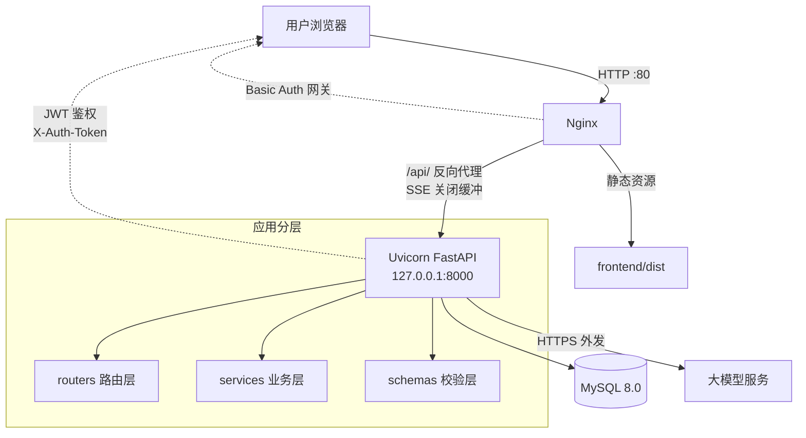

# DeepSeek 智能问答助手

> 基于大语言模型（LLM）的智能对话系统 —— 支持流式输出、深度思考、多会话管理、文件分析，
> 已完成生产级部署并上线运行。

**技术栈**：`Python` · `FastAPI` · `SQLAlchemy` · `MySQL` · `Vue 3` · `Nginx` · `systemd`

| | |
| --- | --- |
| 🌐 **在线演示** | 已部署上线（阿里云 ECS），演示地址与访问口令可联系我获取 |
| 🚀 **一键部署** | `deploy/setup.sh` |
| 🧪 **自动化测试** | `cd backend && python -m pytest tests -q`（10 个用例） |

> 项目已完成生产级部署（Nginx 反向代理 + systemd 进程守护 + MySQL），
> 含访问网关与接口限流；如需在线体验可联系我获取演示地址。

---

## ✨ 功能特性

| 功能 | 说明 |
| --- | --- |
| **账号与数据隔离** | 注册登录，每个用户只能看到自己的对话，聊天记录互不可见 |
| **多会话管理** | 新建、切换、重命名、删除会话；首条消息自动命名；历史长期保存 |
| **流式回答** | 基于 SSE 逐字输出，首字响应 < 1.5s，无需等待整段生成 |
| **深度思考模式** | 一键切换推理模型，展示模型思考过程，适合数学 / 逻辑类问题 |
| **富文本渲染** | Markdown 排版、代码高亮 + 一键复制、KaTeX 数学公式 |
| **文件分析** | 上传代码 / 文本文件，AI 结合文件内容作答 |
| **双模型路由** | 普通对话走快速模型，深度思考走推理模型，环境变量热切换 |

---

## 🏗 系统架构



**几个关键设计：**

| 设计 | 目的 |
| --- | --- |
| 应用只监听 `127.0.0.1:8000` | 不对外暴露，外部流量统一经 Nginx，减少攻击面 |
| Nginx 同时托管前端与反代接口 | 单端口部署，无跨域问题 |
| Nginx Basic Auth + 应用 JWT 双层鉴权 | 外人连页面都看不到；应用内再按用户隔离数据 |
| 应用 JWT 使用 `X-Auth-Token` 自定义头 | 避免与网关的 `Authorization` 头互相覆盖（见踩坑记录） |
| 独立的最小权限 MySQL 账号 | 替代 root 直连，降低泄露风险 |

---

## 📁 目录结构

```
.
├── backend/                     # 后端（FastAPI）
│   ├── app/
│   │   ├── main.py              # 应用入口：装配路由、中间件、静态资源
│   │   ├── config.py            # 集中配置（全部读环境变量）
│   │   ├── database.py          # 数据库引擎与会话
│   │   ├── models.py            # 数据模型：User / ChatSession / ChatMessage
│   │   ├── schemas.py           # Pydantic 请求 / 响应模型
│   │   ├── security.py          # bcrypt 密码哈希 + JWT 签发校验
│   │   ├── deps.py              # 公共依赖：get_db / get_current_user
│   │   ├── routers/             # 路由层：auth / sessions / chat / files
│   │   └── services/            # 业务层：llm（模型调用） / context（上下文裁剪）
│   ├── tests/test_api.py        # 10 个接口自动化测试
│   ├── requirements.txt
│   ├── .env.example             # 配置模板（真实配置在 .env，已 gitignore）
│   └── run.py
│
├── frontend/                    # 前端（Vue 3）
│   ├── src/
│   │   ├── api/index.js         # 统一 API 层（杜绝 URL 硬编码）
│   │   ├── components/ChatWindow.vue
│   │   ├── views/login.vue / chatlayout.vue
│   │   └── stores / router / App.vue
│   └── dist/                    # 构建产物，由 Nginx 托管
│
├── deploy/                      # 📦 部署与运维方案
│   ├── setup.sh                 # 一键部署脚本
│   ├── dsctl                    # 一键启停工具
│   ├── nginx/                   # 站点配置（运行模式 + 维护模式）
│   ├── systemd/                 # 服务单元（进程守护 + 开机自启）
│   ├── maintenance/             # 「服务已暂停」页面
│   └── README.md                # 部署文档（含踩坑记录）
│
└── README-DEPLOY.md             # 线上部署记录
```

---

## 🚀 快速开始

### 本地开发

```bash
# 后端（默认使用 SQLite，无需装数据库）
cd backend
pip install -r requirements.txt
python run.py                       # http://127.0.0.1:8000

# 前端（另开终端）
cd frontend
npm install
npm run dev                         # http://localhost:5173
```

### 一键部署到服务器

```bash
DB_PASS='你的数据库密码' GATEWAY_PASS='你的网关口令' bash deploy/setup.sh
```

脚本会自动完成：安装 Python 3.11 / Nginx → 部署代码 → 建虚拟环境装依赖 →
创建数据库与最小权限账号 → 安装 systemd 服务 → 安装 Nginx 配置 →
生成访问网关密码 → 安装维护页与 `dsctl` → 启动并自检。

详见 [`deploy/README.md`](deploy/README.md)。

---

## ⚙️ 配置说明（`backend/.env`）

| 变量 | 说明 | 默认值 |
| --- | --- | --- |
| `DEEPSEEK_API_KEY` | 模型服务密钥（**必填**） | 无 |
| `DEEPSEEK_BASE_URL` | 模型服务地址（OpenAI 兼容接口） | — |
| `CHAT_MODEL` / `REASONER_MODEL` | 普通对话 / 深度思考所用模型 | — |
| `SECRET_KEY` | JWT 签名密钥 | 需自行设置 |
| `DATABASE_URL` | 数据库连接串 | SQLite |
| `MAX_CONTEXT_MESSAGES` | 上下文保留的最大历史条数 | 20 |
| `MAX_CONTEXT_CHARS` | 上下文最大字符预算 | 24000 |
| `MAX_UPLOAD_MB` | 上传文件大小上限 | 20 |
| `CORS_ORIGINS` | 允许跨域的来源白名单 | localhost |

---

## 🔌 接口一览

| 方法 | 路径 | 说明 |
| --- | --- | --- |
| POST | `/api/register` | 注册 |
| POST | `/api/token` | 登录，返回 JWT |
| GET | `/api/me` | 当前用户信息 |
| GET | `/api/sessions` | 会话列表 |
| POST | `/api/sessions` | 新建会话 |
| PATCH | `/api/sessions/{id}` | 重命名会话 |
| DELETE | `/api/sessions/{id}` | 删除会话（级联删除消息） |
| GET | `/api/sessions/{id}/messages` | 历史消息 |
| POST | `/api/chat` | 对话（SSE 流式） |
| POST | `/api/upload` | 上传附件 |
| GET | `/api/health` | 健康检查 |

---

## 🧪 测试

```bash
cd backend
python -m pytest tests -q
```

覆盖：健康检查、注册登录、重复用户名、弱密码校验、未授权拦截、
会话增删改查、**跨用户越权防护**、上传类型白名单、上下文窗口裁剪。

---

## 📦 部署与运维

| 命令 | 作用 |
| --- | --- |
| `dsctl start` | 启动（对外可访问） |
| `dsctl stop` | 停止（显示维护页，不消耗 API 额度） |
| `dsctl restart` | 只重启后端应用 |
| `dsctl status` | 查看运行状态 |
| `dsctl log 100` | 查看应用日志 |
| `dsctl passwd <新密码>` | 修改访问网关密码 |

资源占用参考（2 核 2G 实测）：Uvicorn 约 100 MB、Nginx 约 20 MB、MySQL 约 300-500 MB。

---

## 🔒 安全实践

- 密码使用 **bcrypt** 加盐哈希存储，不存明文
- 所有会话 / 消息查询均带 `user_id` 过滤，防止越权访问
- 文件上传有扩展名白名单与大小限制，读取时做路径穿越校验
- CORS 使用来源白名单，不使用 `*`
- 前端 Markdown 关闭原始 HTML 渲染，规避 XSS
- `.env` 已被 `.gitignore` 排除，密钥只走环境变量，**绝不入库**
- 应用监听 `127.0.0.1`，不直接对外暴露

---

## 📝 工程记录

### 项目中解决的三个真实问题

**1. SSE 流式输出上线后失效，变成"一次性返回"**

本地测试正常，部署后 AI 回答不再逐字出现。原因是 Nginx 默认开启 `proxy_buffering`
会缓冲后端响应。在 `/api/` 关闭缓冲后恢复，实测单次对话产生 50+ 个流式数据块。

**2. 两种认证抢占同一个 `Authorization` 请求头**

加入 Nginx Basic Auth 访问网关后，接口全部返回 401。原因是网关用
`Authorization: Basic`，应用 JWT 也用 `Authorization: Bearer`，浏览器在收到 401
挑战时会用缓存的 Basic 凭据覆盖 Bearer。最终把应用 JWT 挪到自定义头
`X-Auth-Token`，与网关彻底隔离。

**3. 流式渲染导致输入框卡顿**

流式输出时每个数据块都会触发整页消息重新渲染 Markdown + KaTeX 公式，主线程被占满，
导致输入卡顿、按键延迟才显示。通过 **Markdown 渲染结果缓存 + 流式更新节流**
（渲染频率从约 60 次/秒降至约 8 次/秒）解决。

### 版本演进

| 版本 | 主要变化 |
| --- | --- |
| v1.0 | 课程小组项目：前后端分离、流式对话、思维链展示、文件上传 |
| **v2.0** | 后端分层重构、配置集中管理、MySQL 落地、上下文窗口裁剪、10 个测试用例、安全加固、生产级部署（Nginx + systemd）、渲染性能优化 |

---

## 📄 License

本项目为课程小组实践作品，仅供学习交流。
